  

  
  
  
  
  
  

---

# 🛰️ Awesome OSINT & Geospatial Intelligence (GEOINT) 🌍

> **A definitive, SEO-optimized directory of commercial SaaS platforms and open-source intelligence tools for geospatial analysis, Earth observation (EO) satellites, multi-source geolocation, maritime vessel tracking, radio-frequency (RF) mapping, and visual investigation reconnaissance.**

Whether you are an OSINT investigator, defense analyst, GIS engineer, or threat researcher, this curated index benchmarks the best commercial enterprise solutions alongside battle-tested, self-hosted open-source software.

---

## 📑 Table of Contents
- [📈 Sector Overview & Market Dynamics](#-sector-overview--market-dynamics)
- [🏢 Commercial SaaS & Hosted Platforms](#-commercial-saas--hosted-platforms)
- [💻 Open-Source GEOINT & OSINT Software](#-open-source-geoint--osint-software)
- [📊 Feature Comparison Matrix](#-feature-comparison-matrix)
- [🔍 SEO Search Keywords & Query Taxonomy](#-seo-search-keywords--query-taxonomy)
- [🤝 Contributing](#-contributing)
- [📄 License](#-license)

---

## 📈 Sector Overview & Market Dynamics

The global **Geospatial Intelligence (GEOINT)** and Earth observation analytics market is valued between **$28 billion and $35 billion**, projected to exceed **$90 billion** at a compound annual growth rate (**CAGR of ~12.5% to 14.8%**) fueled by commercial microsatellite mega-constellations, AI-accelerated computer vision (GeoAI), and escalating geopolitical defense requirements.

The sector demonstrates a pronounced **dual market structure**:
- **Upstream (Capital & Constellation Layer) — Highly Concentrated:** Capital-intensive satellite constellations (optical, SAR, RF) and classified government-level prime contracts are concentrated among a few dominant defense primes and space giants (*Maxar/Vantor, Planet Labs, Airbus, BlackSky*), forming natural oligopolies due to massive orbital launch barriers and regulatory hurdles.
- **Downstream (Software, AI Analytics & Services Layer) — Moderately to Highly Fragmented:** End-user geospatial analytics, event detection, automated vector extraction, and niche OSINT software remain highly fragmented across hundreds of specialized SaaS providers, open-source toolkits, and computer vision startups competing to transform raw multi-spectral pixels into actionable decisions.

---

## 🏢 Commercial SaaS & Hosted Platforms

Below is the structured breakdown of top commercial SaaS solutions for OSINT and Geospatial Intelligence, benchmarked by organizational scale (**Valuation / Annual Revenue**) and sorted in descending order:

| 🏢 Platform | 🏷️ Primary Domain / Capability | 💰 Specific Starting Tier Pricing | 🎁 Specific Free Tier / Trial Limit | 📊 Company Size (Valuation / Revenue) |
|---|---|---|---|---|
| **Maxar Technologies** | High-resolution commercial satellite imagery (30cm–50cm), 3D digital surface models, and orbital tasking | **$20.00 – $40.00 / km²** (Archive baseline, min. 25 km² order block ~$500) | **No open free tier**; Free high-res access exclusively via **Maxar Open Data Program** for validated humanitarian crises | **$6.4B Valuation** ($1.6B+ annual revenue; acquired by Advent Intl / Vantor) |
| **Dataminr** | Real-time multi-modal AI event detection & breaking incident alerts from 500k+ public data feeds | **$15,000 / year** (Starting Pulse/First Alert entry tier) | **No self-service free tier**; Customized demo & vetted proof-of-concept on request | **$4.1B Valuation** (Last private round Series F; scaled enterprise ARR) |
| **Recorded Future** | Threat intelligence cloud with automated geospatial infrastructure & threat actor mapping | **$40,000 / year** (Core Tier, single intelligence module with capped API) | **No permanent free tier**; 14-day vetted enterprise evaluation POC upon approval | **$2.65B Valuation** (~$300M ARR; acquired by Mastercard in 2024) |
| **HawkEye 360** | Commercial RF (Radio Frequency) signal geolocation & satellite spectrum mapping | **$50,000 / year** (Entry-level tactical RF data streaming feed) | **No free tier**; Direct defense/government pilot evaluations arranged via mission sales | **$2.42B Valuation** ($117.7M FY revenue; public NYSE listing) |
| **Planet Labs** | Daily planetary Earth monitoring with PlanetScope (~3m) and SkySat (50cm) tasking | **$400 / month** (Starting Insights Flex entry tier via monitoring credits) | **30-Day Free Trial** (Includes **3,000 monitoring credits** for Sentinel/Landsat streaming & spectral indices) | **$850M+ Market Cap** ($378M TTM revenue; NYSE: PL) |
| **Janes** | Defense equipment OSINT, military order of battle, weapons specifications & conflict geolocation | **$30,000 / year** (Single equipment & platform intelligence module) | **No free trial**; Restricted institutional/governmental digital walkthrough upon vetting | **$600M+ Est. Valuation** (~$100M+ ARR; Montagu private equity portfolio) |
| **Spire Global** | Satellite-based maritime AIS tracking, radio occultation weather data & aircraft ADS-B | **$500 / month** (Standard developer Maritime GraphQL API tier) | **No standard free tier**; Custom sample API tokens (100 test queries) on partner sign-up | **$320M Market Cap** (~$72M annual revenue; NYSE: SPIR) |
| **BlackSky** | High-cadence real-time imagery tasking (~1-hour revisit) & Spectra AI automated change detection | **$120 / scene** (Gen-2 archive scenes) / **$250+ / scene** (Standard tasking) | **No public free tier**; Pay-per-scene on-demand accessible via reseller APIs | **$210M Market Cap** (~$105M annual revenue; NYSE: BKSY) |
| **Descartes Labs** | Cloud geospatial platform for petabyte-scale satellite raster analytics & commodity modeling | **$25,000 / year** (Enterprise Accelerator foundation tier on AWS Marketplace) | **No free tier**; Proof-of-concept environment scoped during enterprise evaluation | **$220M Peak Valuation** (~$12M ARR; acquired by EarthDaily Analytics) |
| **Orbital Insight** | Multi-source computer vision analytics (satellite, SAR, mobile location data) | **$30,000 / year** (Orbital Insight GO targeted supply chain / facility tier) | **No free tier**; Customized enterprise pilot sandbox available via sales | **$90M Acquisition Valuation** (~$44M revenue; acquired by Privateer) |

---

## 💻 Open-Source GEOINT & OSINT Software

Open-source tools offer transparency, offline operability, self-hosted deployment, and deep customizability without cloud lock-in. 

The software repos below are **ranked in descending order by GitHub stargazers**, each equipped with its official white social badge linking directly to its stargazers page:

---

### 1. [smicallef/spiderfoot](https://github.com/smicallef/spiderfoot) 
* **Stack:** Python / Flask / SQLite | **License:** MIT
* **Capabilities:** 
  - Automates OSINT for threat intelligence, digital reconnaissance, and infrastructure mapping.
  - Integrates 200+ data modules supporting IP geolocation, domain topology, ASN extraction, and spatial leaks.
  - Provides modular target enumeration with visual threat graph dashboards and automated vulnerability correlation.
* **Best For:** Penetration testers, cyber threat researchers, and investigators needing full-scope passive reconnaissance and infrastructure discovery.

---

### 2. [qgis/QGIS](https://github.com/qgis/QGIS) 
* **Stack:** C++ / Python / Qt | **License:** GNU GPLv2
* **Capabilities:** 
  - The gold-standard open-source Geographic Information System (GIS) for professional spatial data management.
  - Complete raster and vector data manipulation, georeferencing satellite and drone footage, and geospatial modeling.
  - Extensive ecosystem of GEOINT and OSINT plugins (including Sentinel Hub, Google Earth Engine, OpenTopography, and Geocoding APIs).
* **Best For:** Full-scale geospatial analysis, imagery georeferencing, custom map cartography, and spatial defense intelligence.

---

### 3. [simplifaisoul/osiris](https://github.com/simplifaisoul/osiris) 
* **Stack:** Next.js / TypeScript / MapLibre GL / WebGL | **License:** MIT
* **Capabilities:** 
  - Self-hosted, real-time situational awareness dashboard rendering ~19,000+ spatial entities smoothly at 60 FPS using GPU WebGL.
  - 40+ keyless open data feeds: OpenSky flight tracking, NASA FIRMS active fire hotspots, USGS earthquakes, and 17,000+ live public highway CCTVs.
  - Built-in RECON engine featuring network port scanning, WHOIS lookups, DNS inspection, and username fingerprinting across 460+ web platforms.
* **Best For:** Tactical command centers, emergency responders, and OSINT analysts wanting a unified 3D globe visualization tool.

---

### 4. [sacridini/Awesome-Geospatial](https://github.com/sacridini/Awesome-Geospatial) 
* **Stack:** Markdown / Community Catalog | **License:** CC0-1.0
* **Capabilities:** 
  - The definitive global repository indexing open-source geospatial databases, LiDAR toolkits, radar imagery, and GIS utilities.
  - Covers spatial database drivers (PostGIS, SpatiaLite), raster analysis tools, and web-mapping frameworks.
* **Best For:** Engineers and analysts discovering tools, libraries, and datasets across the spatial spectrum.

---

### 5. [gee-community/geemap](https://github.com/gee-community/geemap) 
* **Stack:** Python / Jupyter / ipyleaflet | **License:** MIT
* **Capabilities:** 
  - Python package for interactive planetary mapping with Google Earth Engine (GEE).
  - Analyze multi-decadal optical, thermal, and radar (Sentinel-1 SAR) satellite imagery with minimal coding.
  - Supports time-series animation generation, spectral index calculation (NDVI, NDWI), and automated change detection.
* **Best For:** Remote sensing scientists and environmental OSINT researchers conducting planetary-scale time-series analysis.

---

### 6. [OpenOSINT/OpenOSINT](https://github.com/OpenOSINT/OpenOSINT) 
* **Stack:** Python / MCP / CLI | **License:** Apache-2.0
* **Capabilities:** 
  - Conversational AI agent for digital investigations, featuring 21 public-source passive reconnaissance tools.
  - Model Context Protocol (MCP) server compatibility for integration with Claude Code, Cursor, and custom LLMs.
  - Geolocation tools, IP infrastructure profiling, GDELT global news mapping, and breach queries with strict passive-by-default execution.
* **Best For:** Security teams and automated AI workflows requiring conversational OSINT and spatial data enrichment.

---

### 7. [ilektrojohn/creepy](https://github.com/ilektrojohn/creepy) 
* **Stack:** Python / PyQt | **License:** GPLv3
* **Capabilities:** 
  - Dedicated geolocation OSINT tool collecting geolocation data from social networking platforms and photo-hosting platforms.
  - Extracts EXIF spatial coordinates and geotags, plotting an individual's physical locations on interactive map layers.
* **Best For:** Personnel tracking, social media forensic geolocation, and travel pattern analysis.

---

### 8. [bellingcat/ShadowFinder](https://github.com/bellingcat/ShadowFinder) 
* **Stack:** Python / JavaScript / SunCalc | **License:** MIT
* **Capabilities:** 
  - Bellingcat investigative utility designed to locate where an image could have been taken based on cast shadow lengths and angles.
  - Matches calculated solar elevation and azimuth angles against astronomical models to confirm or refute claimed timestamps and locations.
* **Best For:** Investigative journalists and chronolocation experts verifying photo authenticity and geographic location.

---

### 9. [cogeotiff/rio-tiler](https://github.com/cogeotiff/rio-tiler) 
* **Stack:** Python / Rasterio / NumPy | **License:** BSD-3-Clause
* **Capabilities:** 
  - Dynamic tile-generation engine for Cloud Optimized GeoTIFFs (COG), STAC assets, and satellite imagery.
  - Slices, warps, and mosaic satellite rasters on-the-fly without downloading multi-gigabyte scenes.
* **Best For:** Software engineers building cloud-native satellite imagery viewers and high-throughput tile servers.

---

### 10. [The-Osint-Toolbox/Geolocation-OSINT](https://github.com/The-Osint-Toolbox/Geolocation-OSINT) 
* **Stack:** Markdown / Resource Catalog | **License:** Unlicense
* **Capabilities:** 
  - Comprehensive methodology cheat-sheet and index for image geolocation, street-level identification, and visual clues.
  - Curates architectural guides, license plate databases, signage registries, and satellite comparison platforms.
* **Best For:** Analysts sharpening image geolocation, reverse search techniques, and visual environment identification.

---

### 11. [neonpangolin/geospatial-intelligence-library](https://github.com/neonpangolin/geospatial-intelligence-library) 
* **Stack:** Python / Jupyter | **License:** MIT
* **Capabilities:** 
  - Practical toolbelt for digital investigations, satellite data handling, and investigative GIS operations.
  - Includes scripts for processing optical satellite passes, overlaying border coordinates, and identifying terrain changes.
* **Best For:** Digital investigators and investigative journalists seeking quick, lightweight geospatial processing scripts.

---

### 12. [OsintMeThat/azimut](https://github.com/OsintMeThat/azimut) 
* **Stack:** Python / Svelte / SQLite | **License:** Open Source
* **Capabilities:** 
  - Local-first GeoOSINT workspace preserving digital evidence in an isolated case directory.
  - **3D Horizon Matching:** Stand at any geographic coordinate and render 3D terrain ridges up to 150 km away to align horizons against photographs.
  - **Automated Skyline Finder:** Draw skyline contours and search up to 10,000 km² digital elevation models to pinpoint candidate camera spots.
* **Best For:** Investigators verifying mountain, skyline, and rural photos in privacy-critical environments.

---

### 13. [Xetnus/osm-finder](https://github.com/Xetnus/osm-finder) 
* **Stack:** Python / Overpass API | **License:** MIT
* **Capabilities:** 
  - Developed for Bellingcat's Hackathon to solve visual geolocation via spatial feature intersection queries.
  - Finds geographic coordinates where specific combinations of OpenStreetMap features intersect (e.g., "church within 100m of railway and river").
* **Best For:** Pinpointing locations when a photo features distinct landmarks or linear infrastructure.

---

### 14. [Xpirix/qgis-osint](https://github.com/Xpirix/qgis-osint) 
* **Stack:** Python / QGIS Plugin | **License:** GPLv3
* **Capabilities:** 
  - Real-time geospatial intelligence plugin built directly inside the QGIS environment.
  - Streams ADS-B aircraft positions, maritime vessel feeds, active conflict incident data, and infrastructure layers directly onto QGIS canvases.
* **Best For:** GIS analysts who want a live operational common operating picture (COP) inside desktop GIS.

---

### 15. [Syntax-Error-1337/radar](https://github.com/Syntax-Error-1337/radar) 
* **Stack:** JavaScript / Leaflet / Node.js | **License:** MIT
* **Capabilities:** 
  - Real-time geospatial intelligence platform aggregating flight telemetry, maritime GPS, cyber threats, and GPS jamming interference maps.
  - Interactive multi-layer mapping console for live global threat monitoring.
* **Best For:** Real-time situational awareness and electronic warfare / GPS spoofing monitoring.

---

### 16. [unbihexium-oss/unbihexium](https://github.com/unbihexium-oss/unbihexium) 
* **Stack:** Python / ONNX / PyTorch | **License:** MPL-2.0
* **Capabilities:** 
  - Computer vision and machine learning library for Earth observation and remote sensing.
  - Includes a curated model zoo with ONNX runtime export for building automated satellite object detection pipelines.
* **Best For:** Machine learning engineers developing automated building, road, and ship detectors from satellite feeds.

---

### 17. [xang1234/neptune](https://github.com/xang1234/neptune) 
* **Stack:** Python / Polars / DuckDB | **License:** Open Source
* **Capabilities:** 
  - Open-source maritime tracking engine aggregating open AIS data (NOAA, Danish Maritime, Global Fishing Watch).
  - Identifies loitering behavior, EEZ border crossings, dark fleet transshipment encounters, and port calls using lightning-fast DuckDB spatial queries.
* **Best For:** Maritime OSINT analysts and supply chain sleuths monitoring global shipping corridors.

---

## 📊 Feature Comparison Matrix

| Tool / Platform | License | Core Focus | Geolocation | Satellite Optical / SAR | Maritime AIS | RF / Electronic Intel | Self-Hosted |
|---|---|---|---|---|---|---|---|
| **Maxar Technologies** | Commercial | High-Res Satellite EO | ✅ Advanced | ✅ 30cm Optical/DEM | ❌ | ❌ | ❌ |
| **Dataminr** | Commercial | AI Event Intelligence | ✅ Geotagged | ❌ | ❌ | ❌ | ❌ |
| **Recorded Future** | Commercial | Threat & SecOps Intel | ✅ Contextual | ❌ | ❌ | ❌ | ❌ |
| **HawkEye 360** | Commercial | Radio Frequency GEOINT | ✅ Precision RF | ❌ | ✅ Maritime RF | ✅ Satellite SIGINT | ❌ |
| **Planet Labs** | Commercial | Daily Earth Observation | ✅ High Cadence | ✅ 3m/50cm Optical | ❌ | ❌ | ❌ |
| **Janes** | Commercial | Military Defense OSINT | ✅ Conflict Zones | ❌ | ❌ | ❌ | ❌ |
| **Spire Global** | Commercial | Maritime & Atmospheric | ✅ Vessel/Flight | ❌ | ✅ Global AIS | ✅ GNSS Ro | ❌ |
| **BlackSky** | Commercial | Rapid Revisit AI Imagery | ✅ Near Real-Time | ✅ 35cm-1m Optical | ❌ | ❌ | ❌ |
| **SpiderFoot** | MIT | Attack Surface Recon | ✅ IP/Geo | ❌ | ❌ | ❌ | ✅ |
| **QGIS** | GPLv2 | Full-Featured Desktop GIS | ✅ Native GIS | ✅ Via Plugins | ✅ Via Plugins | ❌ | ✅ |
| **Osiris** | MIT | 3D Situational Dashboard | ✅ WebGL Globe | ✅ Hotspots / MODIS | ✅ Marine Traffic | ❌ | ✅ |
| **geemap** | MIT | Earth Engine Big Data | ✅ Multi-Spectral | ✅ Landsat/Sentinel | ❌ | ❌ | ✅ |
| **OpenOSINT** | Apache-2.0 | Conversational OSINT Agent | ✅ GDELT News/IP | ❌ | ❌ | ❌ | ✅ |
| **ShadowFinder** | MIT | Chronolocation & Shadows | ✅ Solar Geometry | ❌ | ❌ | ❌ | ✅ |
| **Azimut** | Open Source | Horizon & Skyline Match | ✅ 3D Elevation | ❌ | ❌ | ❌ | ✅ |
| **osm-finder** | MIT | Landmark Intersection | ✅ OSM Overpass | ❌ | ❌ | ❌ | ✅ |
| **Neptune AIS** | Open Source | Vessel Analytics & Tracking | ❌ | ❌ | ✅ Multi-Feed AIS | ❌ | ✅ |

---

## 🔍 SEO Search Keywords & Query Taxonomy

To help intelligence teams, defense practitioners, and developers discover relevant tooling via search engines and developer catalogs, this repository indexes the following taxonomy:

- **Primary GEOINT Keywords:** `Geospatial Intelligence`, `GEOINT software`, `Earth Observation platforms`, `satellite imagery analysis`, `commercial satellite tasking`, `SAR satellite analytics`, `Synthetic Aperture Radar OSINT`.
- **Geolocation & Chronolocation:** `photo geolocation tools`, `skyline horizon matching`, `shadow chronolocation analysis`, `OpenStreetMap feature intersection`, `EXIF spatial extractor`.
- **Maritime & Aviation Reconnaissance:** `AIS vessel tracking open source`, `maritime intelligence dashboard`, `dark fleet detection`, `ADS-B flight tracking`, `RF signal geolocation satellite`.
- **OSINT Dashboards & Toolkits:** `situational awareness 3D globe`, `MapLibre WebGL OSINT dashboard`, `Model Context Protocol OSINT agent`, `open source threat intelligence`, `SpiderFoot digital footprinting`.

---

## 🤝 Contributing

Contributions are warmly welcomed! To suggest a new open-source repository or update verified commercial SaaS capabilities:

1. 🍴 Fork the repository.
2. 🌿 Create a descriptive branch: `git checkout -b feat/add-new-tool`.
3. 📝 Follow the existing formatting (include project license, tech stack, key highlights, and official stargazers badge).
4. 🚀 Open a Pull Request with a clear summary of why the tool benefits the GEOINT/OSINT community.

---

## 📄 License

This repository and curated list are released under the [Creative Commons Zero v1.0 Universal](LICENSE) (CC0 1.0) Public Domain Dedication. All referenced third-party trademarks, logos, and software repositories belong to their respective owners.

---

  ⭐ <b>Found this repository valuable for your investigations? Give it a Star!</b> ⭐

